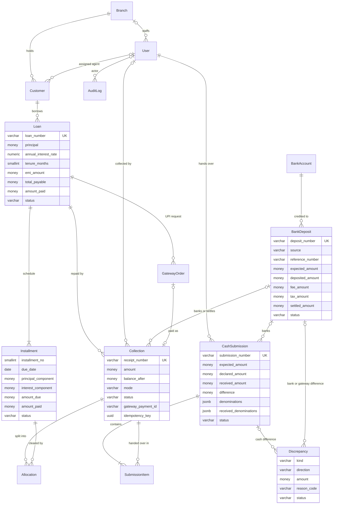

# Database schema

CashTrail uses a single PostgreSQL (15+) database. The schema follows the path the money takes, with one table per checkpoint:

```
Loan ─▶ Installment                         what is owed
Collection ─▶ Allocation ─▶ Installment     what was paid, and which EMIs it cleared
Collection ─▶ CashSubmission                agent hands the cash to the branch
CashSubmission ─▶ BankDeposit               branch pays the cash into the bank
BankDeposit (settled)                       bank statement confirms the credit
GatewayOrder ─▶ Collection ─▶ BankDeposit   UPI: gateway payment, then settlement batch
```

A difference found at any checkpoint becomes a `Discrepancy` row next to the records, which are never edited to make the numbers match. Every change also writes an `AuditLog` row in the same transaction.

## Entity-relationship diagram

`money` is `NUMERIC(14,2)`. Every table has a `bigint` primary key; business tables also have `created_at` and `updated_at`.



## Tables

| Table | Holds | Key columns |
|---|---|---|
| `branches_branch` | Branches | `code` (unique, used in document numbers), `is_active` |
| `accounts_user` | Users and roles | `role` (`AGENT`, `BRANCH_MANAGER`, `FINANCE`, `ADMIN`), `branch_id` (required for agents and managers) |
| `customers_customer` | Borrowers | `customer_code`, contact details, `branch_id`, `assigned_agent_id` |
| `loans_loan` | Loans | terms, `emi_amount`, `total_payable`, running `amount_paid`, `status` (`ACTIVE`/`CLOSED`) |
| `loans_installment` | EMI schedule, one row per instalment | `due_date`, principal and interest components, `amount_due`, `amount_paid`, `status` (`PENDING`/`PARTIALLY_PAID`/`PAID`) |
| `collections_collection` | Repayment receipts | `receipt_number`, `amount`, `balance_after` (loan balance right after the receipt, never changed), `mode` (`CASH`/`UPI`), `status`, one timestamp per lifecycle step, `submission_id`, `deposit_id` |
| `collections_allocation` | Which instalments each receipt cleared | `collection_id`, `installment_id`, `amount`, `reversed_at` (set on void instead of deleting) |
| `reconciliation_cashsubmission` | Cash handed by an agent to the branch | `expected_amount` (sum of receipts, computed on the server), `declared_amount` (agent), `received_amount` (branch count), generated `difference`, the agent's and the branch's note counts, `status` |
| `reconciliation_submissionitem` | Receipts in each hand-over, kept even after a rejection | `submission_id`, `collection_id` |
| `reconciliation_discrepancy` | Differences found at a checkpoint | `kind`, `direction` (`SHORT`/`EXCESS`), `amount`, exactly one of `submission_id`/`deposit_id`, `agent_id`, `reason_code`, `status` (`OPEN`/`RESOLVED`/`WRITTEN_OFF`) |
| `deposits_bankaccount` | Company bank accounts | bank name, last four digits, `is_gateway` (at most one active gateway account) |
| `deposits_bankdeposit` | Branch cash deposits and gateway settlement batches | `source` (`CASH`/`GATEWAY`), `reference_number` (slip or UTR), expected, deposited, fee, tax and settled amounts, `status` (`PENDING`/`SETTLED`/`SETTLED_WITH_MISMATCH`/`FAILED`) |
| `payments_gatewayorder` | UPI payment requests | `provider`, `provider_order_id`, `amount`, `status` (`CREATED`/`PAID`/`FAILED`/`EXPIRED`/`REFUND_DUE`), `collection_id` |
| `payments_webhookevent` | Verified gateway webhooks | unique `(provider, event_id)`, `payload`, `processed_at` |
| `audit_auditlog` | Audit trail | actor, action, entity, `before`/`after` snapshots, IP, request id |
| `core_documentsequence` | Counters for document numbers | prefix, scope, period, last value |

Receipt lifecycle (`collections_collection.status`):

```
CASH: COLLECTED ─▶ SUBMITTED ─▶ BRANCH_RECEIVED ─▶ DEPOSITED ─▶ SETTLED
          │            └─(rejected)─▶ COLLECTED        └─(deposit failed)─▶ BRANCH_RECEIVED
          └─▶ VOIDED (only while the agent still holds the cash)
UPI:  COLLECTED ─▶ SETTLED (through a gateway settlement batch)
```

## Money

- Every amount is `NUMERIC(14,2)` in the database and `Decimal` in Python; the API sends amounts as strings such as `"1500.00"` and rejects floats.
- EMIs are whole rupees, from an exact amortisation rounded per instalment; the last instalment repays exactly the remaining principal.
- `CashSubmission.difference` is a generated column, `expected_amount - received_amount` (positive is a shortage), so it can never disagree with the two amounts.

## Integrity rules in the database

The service layer checks each rule first and returns a clear error; the database enforces the critical ones again, so they hold even for writes that bypass the API.

| Rule | How |
|---|---|
| A loan is never overpaid | CHECK `0 ≤ amount_paid ≤ total_payable` on loans and on each instalment |
| An instalment's status matches what was paid | CHECK on `status`, `amount_paid` and `paid_at` |
| A retried request creates one record | UNIQUE `(user, idempotency_key)` on receipts, submissions, deposits and UPI orders |
| A gateway payment becomes one receipt | partial UNIQUE on `gateway_payment_id`; UNIQUE `(provider, event_id)` on webhooks |
| UPI never enters a branch state | CHECK on `mode` and `status` |
| One hand-over awaiting review per agent | partial UNIQUE on `agent_id` where `status = 'SUBMITTED'` |
| A plain approval means the count matched | CHECK: `APPROVED` requires received = expected; `REJECTED` requires a reason |
| A slip or UTR is used once per bank account | UNIQUE `(bank_account_id, reference_number)`, stored upper-case without spaces |
| A discrepancy has one source | CHECK `num_nonnulls(submission_id, deposit_id) = 1` |
| Nothing is deleted | Every foreign key is `PROTECT`; records are voided, rejected, failed or deactivated |

**Triggers** stop reconciled history from being rewritten, even from a database shell. Each raises `RECORD_LOCKED`, which the API returns as `409`:

- receipts cannot be deleted, can move only along the lifecycle above, and freeze their amount, loan, agent and `balance_after` once handed over; settled and voided receipts are final;
- reviewed hand-overs, settled or failed deposits and closed discrepancies are frozen;
- allocations, instalments, hand-over items and audit entries can never be deleted, and the audit log can never be edited.

## Document numbers

| Document | Example |
|---|---|
| Receipt | `RCT-BLR01-20261017-00012` |
| Cash hand-over | `SUB-BLR01-20261017-001` |
| Bank deposit / gateway settlement | `DEP-BLR01-20261017-001` / `DEP-GATEWAY-20261017-001` |
| Loan / customer | `LN-BLR01-000016` / `CUS-000015` |

Receipt, hand-over and deposit numbers come from a counter row locked inside the same transaction, so a failed request rolls its number back and there are no gaps. All numbers are also UNIQUE in the database.

Migrations live in `backend/apps/*/migrations/`; the integrity triggers are in `backend/apps/audit/migrations/`.
