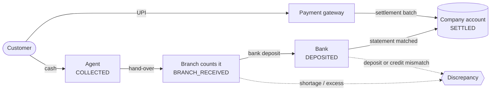

# CashTrail

A Cash Management & Reconciliation System for a lending company. It tracks every loan repayment from the customer, through the collection agent and the branch, to the bank deposit and the company account, and flags any rupee that goes missing on the way.

**Live app:** https://cashtrail-cmrs.vercel.app · **API docs (Swagger):** https://cashtrail-api.onrender.com/api/docs/

The API runs on a free hosting plan that sleeps when idle, so the first request after a quiet period can take up to a minute.

## Documentation

| Document | Contents |
|---|---|
| [SETUP.md](SETUP.md) | Running locally (Docker or manual), demo data, tests |
| [ENVIRONMENT.md](ENVIRONMENT.md) | Every environment variable |
| [DATABASE.md](DATABASE.md) | Database schema, relationships and integrity rules |
| [API.md](API.md) | REST API: authentication, conventions, endpoints (Swagger UI at `/api/docs/`) |

Quick start: `docker compose up --build`, then open http://localhost:3000.

## Test credentials

Every account uses the password **`Demo@12345`**. The login page also has one-click demo sign-in.

| Role | Username | Access |
|---|---|---|
| Admin | `admin` | All branches; users, branches, bank accounts, audit log |
| Finance | `finance` | All branches; bank settlement, gateway settlement, reports |
| Branch manager | `manager.blr` (also `manager.mum`, `manager.del`) | One branch: customers, loans, cash counts, deposits |
| Collection agent | `agent.blr1` (also `agent.blr2`, `agent.blr3`, `agent.mum1`–`3`, `agent.del1`–`3`) | Assigned customers: collect, hand over cash |

## How it works



| Requirement | Delivered |
|---|---|
| **Customer & loan management** | Create and edit customers and loans; reducing-balance EMI schedule generated on creation; outstanding balance, overdue amount and repayment history per customer and loan |
| **Cash collection** (agent) | Assigned customers, overdue first; record full or partial repayments, applied to the oldest unpaid instalment; unique receipt numbers (`RCT-BLR01-20261017-00012`); daily collections; hand cash over to the branch |
| **Branch reconciliation** (branch manager) | Agent collections; count the cash received against the expected amount; approve, approve with a recorded discrepancy, or reject a hand-over; branch summaries |
| **Bank deposit & settlement** | Deposit reconciled cash with bank, amount, date and slip reference; finance confirms each deposit against the bank statement; differences between reconciled, deposited and settled amounts are recorded |
| **Dashboards & reports** | Expected, collected, cash with agents, received at branches, bank deposits, settled, outstanding and discrepancies, filterable by date, branch, agent and status; CSV exports |
| **Roles & security** | JWT authentication, four roles with role-based access, and each user sees only their own branch or customers |

Lifecycle: `Expected → Collected → Branch Received → Bank Deposited → Settled`. UPI repayments (optional gateway) go from collected straight to settled through gateway settlement batches.

## Business cases

| Case | How it is handled |
|---|---|
| Partial repayment | Accepted; fills the oldest unpaid instalment first and marks it partly paid |
| Over-collection | A repayment above the outstanding balance is refused (`422`); extra cash found at the branch count is recorded as an excess discrepancy, never credited to a loan |
| Duplicate collection | A retried request returns the original receipt (idempotency key); the same loan, amount and agent within 10 minutes needs explicit confirmation |
| Cash discrepancy | The branch count is compared with the receipts; any difference needs a reason and opens a shortage or excess discrepancy against the agent |
| Rejected cash submission | Rejected with a reason; the receipts go back to the agent to resubmit |
| Bank deposit mismatch | Checked when the deposit is made and again against the bank statement; each difference opens a discrepancy |
| Duplicate bank reference | A slip number or UTR can be used only once per bank account (`409`) |
| Unauthorized modification of reconciled transactions | No edit or delete endpoints for reconciled records; database triggers block changes even outside the app (`409 RECORD_LOCKED`); every change is in the audit log |
| Failed or delayed settlement | A deposit unsettled after 2 days is flagged as delayed; a failed deposit returns its cash to the branch for redeposit |

## Assumptions

1. Amounts are Indian rupees, stored as exact decimals (`NUMERIC(14,2)`); dates use Asia/Kolkata.
2. Loans use reducing-balance EMIs in whole rupees; the last instalment absorbs the rounding. There are no late fees.
3. Cash is collected in whole rupees, so a branch can count it exactly; UPI may include paise.
4. A repayment pays the oldest unpaid instalment first, and a loan can never be paid beyond its outstanding balance.
5. Only the customer's assigned agent can collect from them.
6. An agent hands over whole receipts and has at most one hand-over awaiting review; counting the notes is the branch manager's job (the agent may count too, optionally).
7. A bank deposit carries whole approved hand-overs from a single branch.
8. Reconciled records are never edited; corrections are made through discrepancies. Nothing is deleted.
9. The person who records a deposit cannot also confirm its settlement, and an agent cannot review their own cash.
10. A deposit is delayed once unsettled for more than 2 days (configurable).

## Tech stack

| Area | Choice |
|---|---|
| Frontend | Next.js 16, React 19, TypeScript, Tailwind CSS, shadcn/ui |
| Backend | Python, Django 6.1, Django REST Framework |
| Database | PostgreSQL |
| API | REST |
| Authentication | JWT (access and refresh tokens, held in httpOnly cookies by the Next.js server) |
| Authorization | Role-based access control with per-branch and per-agent data scoping |
| Financial data | `NUMERIC(14,2)` and Python `Decimal` throughout; amounts travel as strings, never floats |

Optional technologies used, and why:

| Technology | Why |
|---|---|
| TypeScript | Types are generated from the API schema, so a backend change that breaks the frontend fails the build |
| Docker | One command runs the database, API and web app with demo data |
| Pytest | 1,200+ tests cover the business rules, database constraints, permissions and concurrent requests |
| Swagger / OpenAPI | Live, always-current API documentation at `/api/docs/` |
| CI/CD | GitHub Actions runs linting, type checks, tests and the build on every push |
| Logging | Every request has an id that appears in the logs, the response and the audit trail |
| Payment gateway sandbox | Cashfree (or Razorpay) sandbox for UPI repayments, with a built-in mock so it works without keys |
| Automated testing | The tests run against a real PostgreSQL, including the database triggers and concurrent requests |

Redis and Celery are not used: the only background work is three small scheduled commands, and nothing needs a queue to be correct.

## Architecture

The browser talks only to the Next.js server, which holds the session and forwards calls to the Django API; the API runs every business rule inside a database transaction and writes the audit log; PostgreSQL enforces the critical rules again with constraints and triggers. Details of each layer are in [DATABASE.md](DATABASE.md) and [API.md](API.md).

```text
backend/    Django project: one app per domain (customers, loans, collections,
            reconciliation, deposits, payments, dashboard, audit)
frontend/   Next.js app: screens for agent, branch manager, finance and admin
docker-compose.yml, .github/workflows/ci.yml
```

## Trade-offs and future improvements

- **Synchronous Django with row locks:** simple and correct for money; requests on the same loan run one after another.
- **PostgreSQL-specific integrity:** triggers and constraints protect the data even outside the app, at the cost of tying the backend to PostgreSQL.
- **No offline recording:** receipt numbers and balance checks need the server, so an agent without signal must wait to record.

With more time: automated frontend and end-to-end tests in CI, bank statement import for automatic matching, refunds through the gateway, and an offline queue for agents in low-signal areas.
